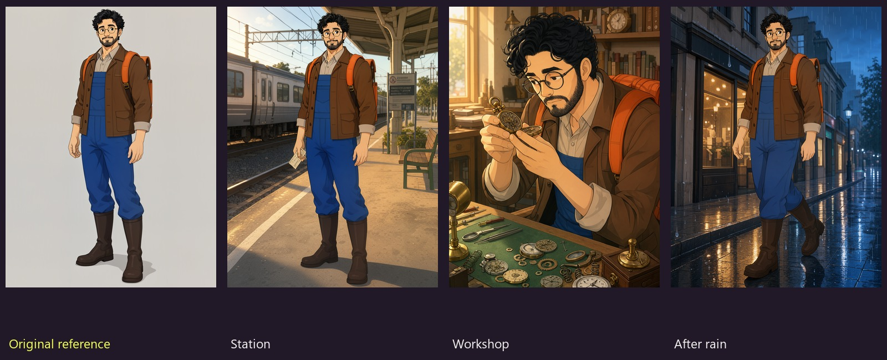
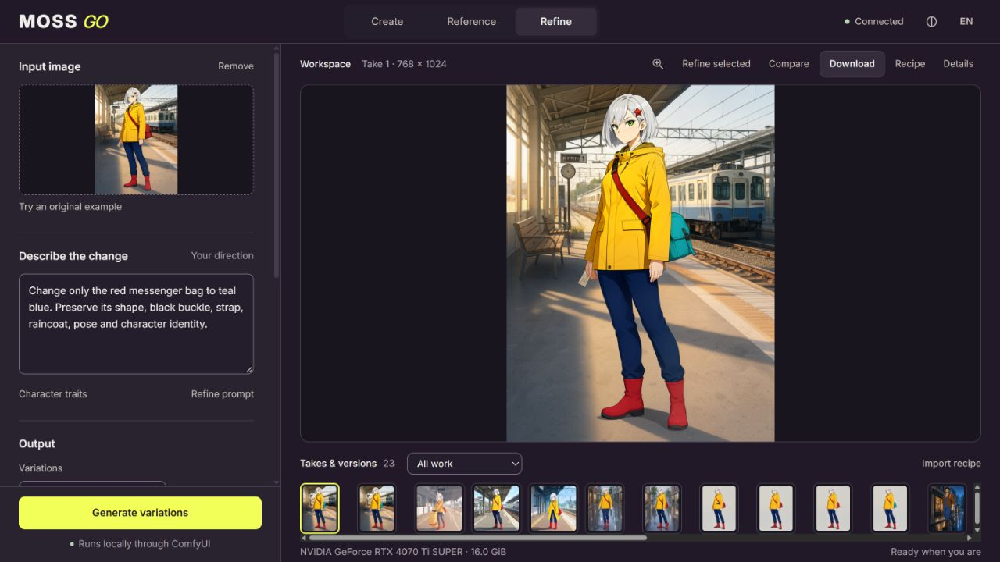
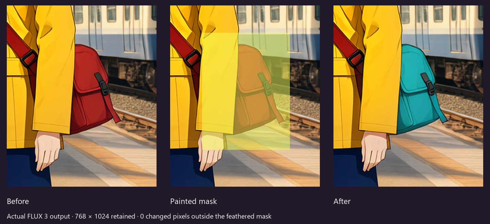

# MOSS GO

**One character. Many scenes. Every detail under control.**

**FLUX 3 release · November 3, 2026 · 0.2.0-rc.1**

An open-weight image studio powered by **FLUX 3 Image Klein and ComfyUI**.
Create original characters, carry their visual identity into new scenes, edit a
painted detail, and keep the result together with its actual execution graph.

[Watch the 1:57 narrated demo](https://oceannin.github.io/MOSS-GO/) · [Get 0.2.0-rc.1](https://github.com/Oceannin/MOSS-GO/releases/tag/v0.2.0-rc.1) · [Measured results](docs/FLUX3_BENCHMARK.md)



The same original character at a station, examining a watch, and walking after rain.
These are local model outputs, not interface mockups or promotional generations.
The complete evaluation includes less successful cases too.

## See the studio in action

[](https://oceannin.github.io/MOSS-GO/#demo)

[Watch the narrated walkthrough](https://oceannin.github.io/MOSS-GO/?release=flux3-20261103#demo): Create an
original design, direct a reference scene, paint one detail, then export the take
with its actual workflow. This capture is from the installed 0.2.0rc1 studio. The demo uses real application
captures, with synthetic narration and original accompaniment; see
[audio provenance](docs/AUDIO_PROVENANCE.md).

## Change a detail. Keep the rest.



Refine includes nearby context, restores the generated crop to the source
coordinates, and composites through the feathered mask. The demonstrated bag
edit kept the original 768×1024 canvas with **zero changed pixels outside the
effective mask**. Nearby details inside the selection can change.

## A studio, with its work intact

- **Create, Reference and Refine** use FLUX 3 by default. FLUX.2 Klein and MOSS remain
  explicit alternatives; a failed FLUX 3 request never silently switches models.
- **Official local prompt upsampling** uses Qwen3.5 9B, including image context.
  Already detailed captions can bypass it. Original and actual expanded text are
  saved; **Details** shows models, precision, steps, seed and runtime versions.
- **Takes, scene packs and related versions** persist in a separate SQLite catalog.
  Jobs run sequentially; launch identifiers support recovery without duplicate batches.
- **Portable ZIP recipes** include inputs, masks, results, a contact sheet and the
  saved ComfyUI API graphs. Import prepares settings for review; it never generates automatically.
- **Original character references and optional traits** provide a starting point.
  Pins preserve text while randomizing; they do not guarantee a model's visual adherence.
- **English on first launch**, optional Russian, two original themes, local Inter,
  keyboard rectangle masks, image inspection and input/result comparison.

The optional Ollama prompt assistant remains a separate, manual review tool. It
is not the FLUX 3 upsampler, and Ollama is not required by the image workflows.

## Quick start

Use a compatible **ComfyUI 0.41.2 or newer** and install this checkout as
`ComfyUI/custom_nodes/moss-go`. The standalone wheel does not replace the node
pack needed for masks and addressed cancellation. Keep your existing runtime and
catalog recoverable when upgrading. The tested runtime is recorded in the
[model guide](docs/MODELS.md).

Create a separate studio environment from the checkout:

```powershell
python -m venv .venv
.\.venv\Scripts\python.exe -m pip install --require-hashes --only-binary=:all: -r requirements.lock -r build-requirements.lock
.\.venv\Scripts\python.exe -m pip install --no-deps --no-build-isolation .
```

FLUX 3 weights require your own accepted Hugging Face access. Read the model's
[conditions](https://huggingface.co/black-forest-labs/flux-3-image-klein-comfy),
then authenticate with `hf auth login` or your local `HF_TOKEN`. The installer
never accepts terms for you or sends the token to download redirects.

```powershell
.\.venv\Scripts\moss-go-models.exe download --models-dir "C:\ComfyUI\models" --pack flux3-balanced
.\.venv\Scripts\moss-go.exe --comfy http://127.0.0.1:8188
```

Replace the model directory with your own. Start/restart ComfyUI after installing
nodes and weights. Open **http://127.0.0.1:8191/moss-go/**. On Linux, the equivalent
studio commands are `.venv/bin/python`, `.venv/bin/moss-go-models` and `.venv/bin/moss-go`.
See the [complete installation guide](docs/INSTALL.md).

The interface can be explored before ComfyUI is connected. **Models & connection**
reports missing files, nodes and loader compatibility. An incomplete setup cannot
enqueue a generation. High precision requires its own files; it does not substitute INT8.

## Hardware and measured limits

Tested locally on **RTX 4070 Ti SUPER 16 GB, 32 GB RAM, Windows**. The default
pinned pack is distilled INT8 with an INT8 Qwen3-VL encoder, INT8 official
upsampler and compatible VAE: **20.77 GB of files**. No NVFP4 is used on this Ada GPU.

A 13-case evaluation covers three Create prompts, six scenes with two original
characters, and four local edits. Every job completed; all four edits preserved
pixels outside the feathered mask. Identity and action adherence are separate:
one initial Mira walking case kept a standing pose. See the
[complete results and limitations](docs/FLUX3_BENCHMARK.md), not just the showcase.

Other physical GPU sizes and Linux GPU execution remain unverified. Profiles are
memory budgets, not hardware guarantees. The 32 GB machine had limited spare RAM
while upsampling; keep enough system memory available. Model caching can retain
memory between jobs. The app preserves work and holds the affected batch on memory failure.

## Reproduce a take

Open **Recipe** on a saved output. The ZIP contains the exact saved graph and
observed prompt metadata, together with the source and mask. For another ComfyUI
installation, upload the bundled input images and bind the graph's image loader
filenames to those uploads. Model identifiers and sampling parameters stay explicit.

[Example native API graphs](workflows/README.md) · [Model sources and hashes](docs/MODELS.md) · [Launch recovery](docs/RELEASE_NOTES.md)

Existing FLUX.2/MOSS recipes and explicit saved engine choices remain supported.
Catalog schema 2 is retained; observed captions use an additive table without
changing old launch snapshots. Data defaults to `%LOCALAPPDATA%/MOSS-GO` on Windows
or `~/.local/share/MOSS-GO` elsewhere; `--data` selects a different catalog.

## Development and release evidence

```sh
python run_tests.py
npm ci
npm test
npm run check
npm run format:check
```

CPU checks do not establish GPU compatibility or visual quality. The real-job
benchmark has a resumable ledger and preserves failures. Source and wheel checks,
release limits and manual checks are in [INSTALL](docs/INSTALL.md),
[RELEASE_NOTES](docs/RELEASE_NOTES.md) and [MANUAL_CHECK_RU](docs/MANUAL_CHECK_RU.md).

## Licenses and credits

Application code: **Apache-2.0**. FLUX 3 transformer weights: **FLUX Kommunity
License v1.0**, separately from the application. Encoder, official prompt upsampler
and compatible VAE retain their own upstream licenses. No weights or credentials
are bundled. [Third-party notices](THIRD_PARTY_NOTICES.md) include the MIT workflow
attribution, reference-attention attribution, Inter OFL and dependency records.

Independent project; no endorsement by Comfy or Black Forest Labs is implied.
The [previous 0.1.0-rc.1 release](https://github.com/Oceannin/MOSS-GO/releases/tag/v0.1.0-rc.1)
and its FLUX.2 demonstration remain available for rollback.
