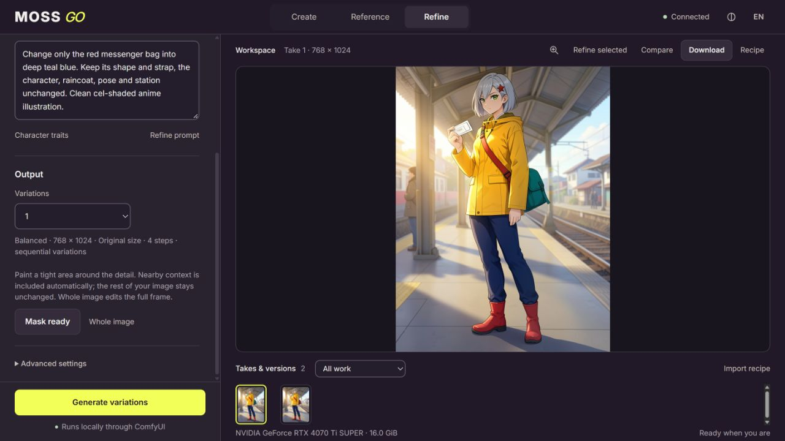
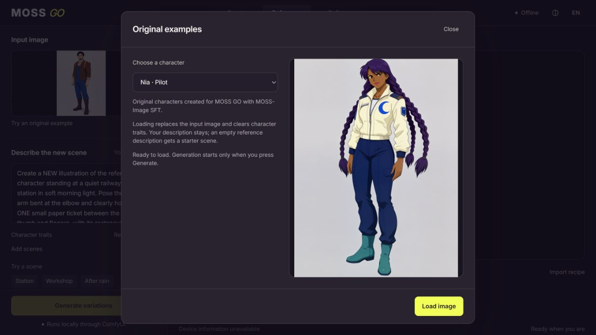

# MOSS GO

[](https://github.com/Oceannin/MOSS-GO/actions/workflows/checks.yml)

A local studio for images, character scenes and masked refinements, powered by ComfyUI.

**Contest preview · 0.1.0-rc.1.** Create images, keep an original character across
scenes, refine a selected area and export the recipe and ComfyUI graph. The default
reference engine is FLUX.2 Klein 4B; MOSS SFT is available for creation.

Tested on Windows with RTX 4070 Ti SUPER 16 GB and 32 GB RAM. The standalone
studio also passed fresh Windows source and wheel installation without Torch.
See [measured results](docs/BENCHMARK.md), [known limits](docs/RELEASE_NOTES.md)
and the [Russian submission guide](docs/SUBMISSION_RU.md).
The [example API graphs](workflows/README.md) show the ComfyUI pipeline directly.

[Watch the 1:48 demo](https://oceannin.github.io/MOSS-GO/) · [Download the preview](https://github.com/Oceannin/MOSS-GO/releases/tag/v0.1.0-rc.1)



## Run from source

Use Python 3.11 or newer and a separate virtual environment. Follow the
[installation guide](docs/INSTALL.md) for the pinned dependencies and package checks.
After installation, run the studio from that environment:

```powershell
.\.venv\Scripts\moss-go.exe
```

```sh
.venv/bin/moss-go
```

Connect a compatible ComfyUI on `http://127.0.0.1:8188` when ready to generate.

Open **http://127.0.0.1:8191/moss-go/**. English is the initial language, independent
of browser and system settings. Language and theme choices are saved explicitly.

You can explore the interface without ComfyUI. **Try an original example** opens
three character references made for this project. Choose and load an image, then
review the starter scene. Preview and loading never run a model. Your description
is retained when present; loading explicitly clears the previous character traits.



ComfyUI portable Python can also run `run.py` directly when its environment includes
the dependencies. The launcher handles portable Python's isolated module search path.

Data defaults to `%LOCALAPPDATA%/MOSS-GO` on Windows or `~/.local/share/MOSS-GO` on
Linux. Use `--data /path/to/catalog` to choose another catalog. The studio binds only
to `127.0.0.1`; its local HTTP endpoint is not intended for direct public hosting.

Catalog schema 2 adds structured failure reasons. A schema 1 catalog is upgraded
without changing jobs, execution snapshots or images. Keep a copy of an existing
catalog before updating; older builds cannot open the upgraded catalog.

## ComfyUI node pack

Place this checkout in `ComfyUI/custom_nodes/moss-go` or link it there. Restart
ComfyUI after installation. The pack uses distinct `MossGo*` names and does not
replace the personal MOSS Image Studio extension.

The current MOSS workflow also needs the OpenMOSS `moss-image` plugin loaders.
The [model setup guide](docs/MODELS.md) records the tested plugin and ComfyUI
revisions and provides pinned, checksum-verified model downloads. A fresh GPU
runtime installation and additional physical GPUs remain unverified.
The built-in connection panel reports missing files and nodes instead of pretending
an incomplete setup is ready.

## Hardware and models

- Reference development machine: RTX 4070 Ti SUPER 16 GB, 32 GB system RAM, Windows.
- 12 and 24+ GB profiles are **unverified recommendations**, not measured support claims.
- The high-precision profile requires its own weights; it does not silently substitute INT8.
- Variations run sequentially. Refinement and image generation do not require a language model.
- Automatic uses GPU capacity, with Memory saver as the fallback when capacity is
  unknown. Free RAM and VRAM are shown separately in Models & connection.
- Readiness is checked for the selected mode and precision. A missing edit node
  does not disable creation; absent high-precision weights never fall back to INT8.

If a job runs out of memory, the worker holds only its batch's unsubmitted takes.
The failure and hold are saved in one database transaction.
Inputs, settings, completed results and unrelated batches remain available. Select
a failed or held take to load one attempt for review; GPU-memory failures offer
Memory saver, while system-RAM failures retain the original profile and explain
that CPU encoding may increase RAM use. Loading settings never starts a generation.
The new attempt stays linked to the original take in Related versions.

MOSS SFT is used for text-to-image. FLUX.2 Klein 4B is the default reference and refinement engine:
17/18 usable results in the assistant-reviewed follow-up on three original anime
characters. MOSS CharRef remains experimental. See [the complete method and limitations](docs/BENCHMARK.md).

## Masked refinements

Choose **Refine**, add an image, then **Paint an area**. Paint close to the detail
you want to change. FLUX processes small selections with nearby context, then
returns the edit to the original image coordinates and dimensions. The final
composite protects pixels outside the softened mask. **Whole image** uses the
full frame; saving an empty mask returns the unchanged input without running a model.

Reopening the painter retains the mask. Undo, Redo and reversible Clear work on
the current draft; closing without **Use this mask** discards draft changes.
**Select rectangle · keyboard** offers a keyboard-accessible alternative to painting.
MOSS SFT remains selectable, with its own refinement-strength control. FLUX uses
its native four-step edit workflow, so strength, quality and negative-prompt
controls are hidden for that engine.

Six development cases passed the localized-edit check on three illustrated
characters. This is limited coverage: nearby details inside the painted region
can also change. See the [comparison and qualification](docs/BENCHMARK.md#localized-refinement).

## Launch recovery

The studio records a launch before sending it. If confirmation is lost, settings
are held while it checks the existing request. **Recover previous launch** reuses
the same settings and identifier; it does not create another batch. The pending
request survives a page reload when browser storage is available. If storage is
blocked, the interface asks you to keep the tab open for recovery. Accepted batches
remain in the studio catalog independently of the browser.

The worker reconciles an uncertain ComfyUI launch against the existing queue and
history. Temporary disconnections and interrupted image downloads retain the
same native prompt ID. A missing launch is never silently resubmitted. Finished,
failed, interrupted and cancelled catalog entries cannot be overwritten by a late
queue response.

## Optional prompt assistant

The optional assistant uses local Ollama with the pinned
`qwen3:4b-instruct-2507-q4_K_M` model. It proposes text for review;
it does not modify a prompt without Apply. It runs on CPU, unloads after the request,
and is kept outside the image workflow. The image studio works without Ollama.
The review shows additions/removals and an editable suggestion; closing it keeps
the original. Clear descriptions may need no changes. See the
[setup, measured checks and limitations](docs/ASSISTANT.md). Character traits remain
separate from the editable scene and are attached by the image-request builder.

## Character descriptions

Open **Character traits** to start from Mira, Theo, Nia or a custom description.
Twelve optional fields cover identity, wardrobe, expression and medium. Pin the
details you want to keep, then use **Randomize unlocked** to explore the rest.
Pins preserve selected text during randomization; they do not guarantee a model's
visual adherence. Nothing reaches the workspace until **Apply traits**.

**Export preset** saves the draft and its pins as portable JSON. **Import preset**
first shows a clean draft and reports unsupported legacy fields. Closing the dialog
discards unapplied changes. The interface can be Russian while the model-facing
description and portable values stay in English. Applied values and pins survive
a page reload. Importing or editing a character does not enqueue image generation.

## Development checks

```sh
python run_tests.py
npm ci
npm test
npm run check
```

These are CPU checks. They do not prove image quality or GPU compatibility. The
benchmark script in `scripts/benchmark.py` submits real jobs and records their IDs;
it distinguishes unapproved/rejected reference fixtures from engine comparison runs.

## Credits and licenses

The application is licensed under Apache-2.0. The two default model packs have
pinned sources, hashes and license references; experimental CharRef weights are
not part of those packs or the contest demonstration.
Inter is distributed under its included SIL Open Font License. Reference attention
adapts the Ostris design; its MIT notice is preserved in `moss_go/nodes/`.
Model weights and ComfyUI retain their own licenses and are not included in this repository.
The [dependency record](docs/DEPENDENCIES.md) lists the pinned studio dependencies
and their packaged license declarations.
