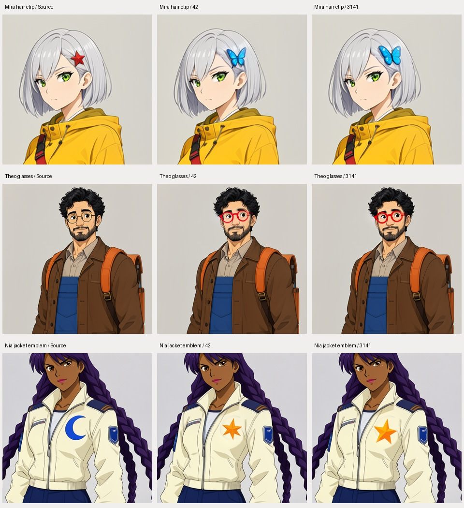

# Image-engine evaluation

Development evidence, reviewed by the assistant. This is not an independent human
study or a promise that a competition judge will award the product.

Three original anime characters were tested in three scenes with seeds 42 and
3141: 18 cases per engine. A usable image must preserve at least four declared
identity markers, visibly fulfill the scene's core action and setting, retain the
requested illustration style, and avoid a major defect requiring external repair.
The release threshold was set at 15/18 before the comparison.

| Round | Engine | Mira | Theo | Nia | Usable |
| --- | --- | --- | --- | --- | --- |
| Baseline | MOSS CharRef | 3/6 | 2/6 | 1/6 | 6/18 |
| Baseline | FLUX.2 Klein 4B | 4/6 | 4/6 | 5/6 | 13/18 |
| Action instructions v2 | FLUX.2 Klein 4B | 5/6 | 6/6 | 6/6 | 17/18 |

FLUX preserved identity and style more consistently, but the baseline often copied
the standing pose for a walking scene. The follow-up described a visible stride
and the desired hand/object interaction explicitly. It repeated all 18 cases,
including baseline successes, with the same references and seeds. It tests FLUX
only; it is not a second two-engine comparison. One watch scene remains a failure
because the character looks toward the viewer rather than examining the watch.
Exact left/right limb choreography and readable ticket printing are not guaranteed.

FLUX is the selected reference engine. MOSS SFT remains the text-to-image engine;
CharRef remains experimental. The application does not silently rewrite a user's
prompt. The tested starter descriptions are explicit, editable text.

The MOSS baseline also exposed an inherited memory-estimator shape bug: 16 attempts
failed before generation. After the flat-shape fix, all failed cases were repeated
without changing seeds, scenes or inputs. Failed attempts remain in the local ledger.
The visual scores above concern the resulting completed images; runtime failures
have not been counted as successful images or erased.

Reference hardware: RTX 4070 Ti SUPER, 16 GB VRAM, 32 GB system RAM; portrait 768×1024,
locally installed quantized weights. Other GPU sizes, fresh installation, broad
character/style coverage and release packaging remain separate acceptance gates.

Configurations are in `moss_go/assets/benchmark_cases.json` and
`moss_go/assets/benchmark_action_v2.json`. Local ledgers, contact sheets and per-case
review notes are retained under `.local/benchmark/` and are not uploaded by default.

Run a separate follow-up without replacing earlier evidence:

```powershell
python scripts/benchmark.py compare --cases moss_go/assets/benchmark_action_v2.json --engine flux-klein --references-from .local/benchmark/report.json --report .local/benchmark/action-v2.json --summary
python scripts/benchmark.py status --report .local/benchmark/action-v2.json --summary
python scripts/review_sheets.py --report .local/benchmark/action-v2.json
```

## Localized refinement

FLUX.2 Klein 4B now processes small painted selections with surrounding context.
The context crop is enlarged within the memory profile's budget, generated with
native reference conditioning, restored to its original size, and composited at
its original coordinates. Feathering is calculated on the original full-size
mask before cropping. The source remains the final composite destination.
Large/full-image selections use the complete frame. MOSS retains its masked
image-to-image workflow and remains selectable.

The initial full-frame badge smoke failed the requested shape change with both
engines, although outside pixels were preserved. Its broad mask and imprecise
badge description were changed for the subsequent crop pilot; that pilot does
not isolate framing as the sole cause of improvement. The integrated evaluation
then used three different original characters and three distinct edit requests,
with seeds 42 and 3141 for each. No prompt rewriting was performed.

Before running these six cases, the initial gate was set to at least 5/6 usable edits, at least
one success per case, unchanged dimensions and zero changed pixels outside the
feathered mask for every result.

| Requested change | Seed 42 | Seed 3141 | Changed pixels outside mask |
| --- | --- | --- | --- |
| Mira: red star clip → blue butterfly clip | Usable | Usable | 0 in both |
| Theo: round eyeglass frames → vivid red | Usable | Usable | 0 in both |
| Nia: blue crescent emblem → orange five-point star | Usable | Usable | 0 in both |

All six outputs retained the original 768×1024 dimensions. The comparison below
shows the original context at left, then the two edited results. These are actual
output crops, not independently generated mockups.



This is assistant visual review, not independent human scoring. Frame thickness
and nearby facial rendering vary slightly inside Theo's selection; preservation
inside a painted region is not guaranteed. These six cases cover illustrated
characters on the 16 GB reference machine, not arbitrary edits, photographs, or
other GPU capacities. The local complete ledger and pixel measurements are in
`.local/qa/refine-focus-benchmark.json`; the earlier failures and crop pilot are
retained separately. FLUX is the default for new refinement workspaces; an
explicitly saved engine choice is retained.

Boundary regressions also completed: an empty mask returned the original artifact
with no native prompt and zero elapsed model time; a full mask executed the native
workflow and changed the gray background to pale yellow. An enlarged 1538×2050
source retained those exact, non-multiple-of-16 output dimensions under the economy
profile, with 3,130,620 pixels outside the softened mask unchanged and the butterfly
edit visible. That economy run used the same physical 16 GB GPU and does not verify
a 12 GB device. Boundary evidence is retained in `.local/qa/refine-boundaries.json`.
