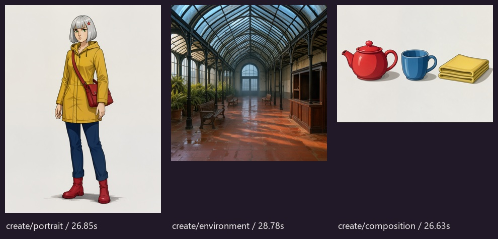
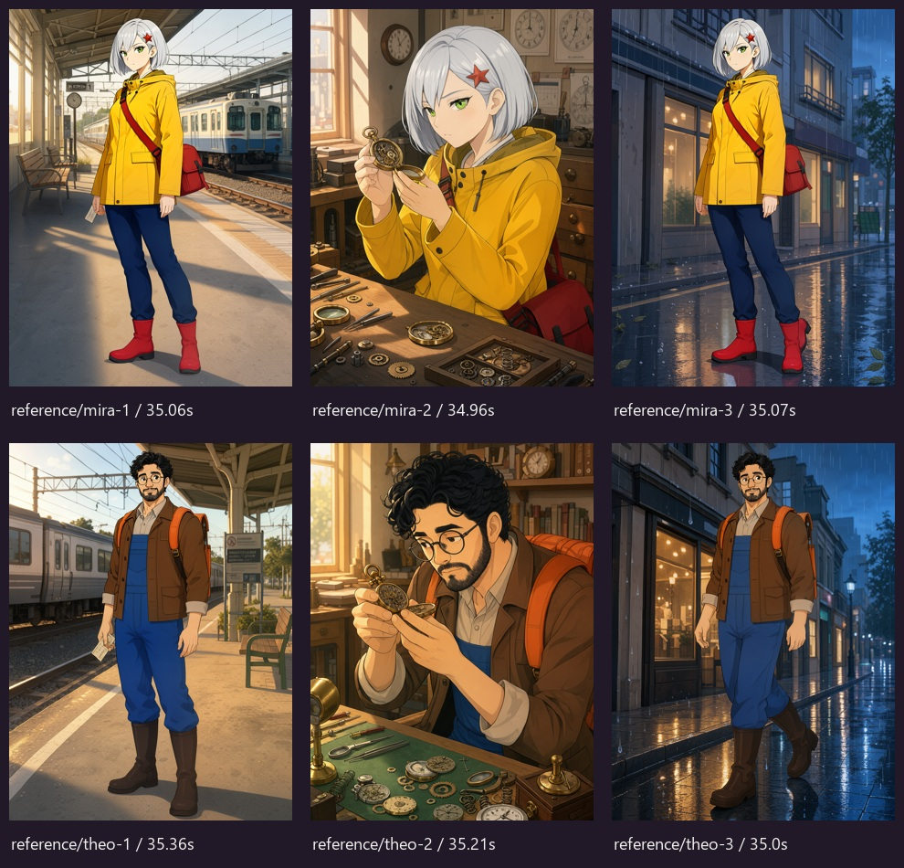
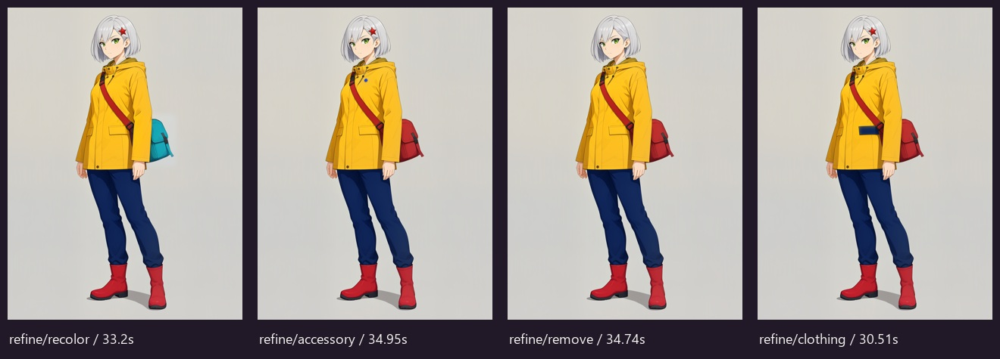

# FLUX 3 validation — November 3, 2026

Status: actual GPU evaluation completed; release checks are recorded separately. This report records actual local GPU executions, separately
from unit tests. It does not reuse the previous FLUX.2 review scores.

## Runtime and components

- Windows, RTX 4070 Ti SUPER 16 GB, 32 GB system RAM.
- Isolated ComfyUI v0.41.2 (`b53f77a74e21091cbdebfdf7b85fc80326932646`),
  Torch 2.14.1+cu130, Python 3.13.12, NVIDIA driver 621.01.
- Official pinned BFL Comfy repository revision
  `9d36114cf7a2e03a45c28f5cc4987d20ebfdb6c1`; all four downloaded files
  passed their published SHA-256 values.
- Distilled transformer INT8 ConvRot, Qwen3-VL 4B INT8 ConvRot, official
  Qwen3.5 9B prompt upsampler INT8 ConvRot, compatible FLUX.2 VAE.
- Euler/simple, CFG 1, 16 steps, Flux sampling shift ln(16), seed 42.
- No NVFP4 kernels or hosted model API were used.

## Completed initial executions

| Execution | Size | Prompt preparation | Time | Sampled device VRAM peak |
| --- | --- | --- | --- | --- |
| Official distilled Create path, fox | 1024×1024 | Explicit complete caption; upsampler bypass | 22.59 s | 13.31 GiB |
| Official distilled Reference path, Mira at station | 768×1024 | Explicit complete caption; upsampler bypass | 10.04 s | 12.68 GiB |
| Official Create with prompt upsampler, three-object composition | 1024×1024 | Actual official Qwen3.5 9B INT8 generation | 62.26 s | 15.19 GiB |
| MOSS GO UI Create, original courier | 768×1024 | Actual official upsampler; 1,370-character observed caption | 63.18 s | Not monitored for this UI run |

These are individual observations, not averaged latency estimates. Reference
reused cached model/encoder/VAE loaders. The upsampler probe followed an explicit
idle cache release; the UI Create used a newly started runtime.

The first three rows were measured from API submission through downloaded
history/output. VRAM is sampled device-wide, including the desktop and other
applications, rather than a Torch allocation peak. Peak ComfyUI working sets were
approximately 10.97, 11.84 and 15.15 GiB respectively. System-wide used RAM peaks
were approximately 27.45, 27.89 and 29.12 GiB; other applications were running.
The UI row uses the studio's stored job elapsed time.

The reference image was inspected: the silver bob, green eyes, red star clip,
yellow coat, navy trousers, red boots and red bag remained recognizable, with the
requested railway setting and held ticket. This is one assistant-reviewed case,
not a general identity guarantee. The three-object output visibly contains the
requested separate red teapot, blue cup and yellow cloth in their requested order.

The executed graphs and actual upsampler captions were saved. The first UI take
is `53b1b268b1274272b19a5fb369c8afbd`; it completed using
`flux3-image-klein-int8-convrot.safetensors` and appears in persistent history.

## Application interface acceptance

All three jobs below were started with the actual MOSS GO interface and saved
with their real expanded prompt, components and execution graph. English was
the fresh-origin default. History and settings survived a browser reload.

| UI workflow | Job identifier | Size | Stored time |
| --- | --- | --- | --- |
| Create | `53b1b268b1274272b19a5fb369c8afbd` | 768×1024 | 63.18 s |
| Reference | `905a4f32404549669c8d90459a45aa04` | 768×1024 | 35.09 s |
| Refine | `0c6b0cf89f744c4b96c775b64bcbf816` | 768×1024 retained | 30.95 s |

The UI Refine changed 38,105 pixels, all inside the effective feathered mask;
zero changed outside. Its bag changed to teal while the rest of the original
canvas remained intact. The permitted region includes the feather support,
not only the painted white rectangle. Mask feather radius was 8 pixels.

## Frozen 13-case evaluation

The [case fixture](../moss_go/assets/flux3_evaluation_cases.json) was frozen before
execution (its `planned; not executed` field records that preparation state).
[The resulting ledger](evidence/flux3-evaluation.json) separately records all
13 completed jobs, exact settings, actual graphs, observed captions and memory
samples. Configuration SHA-256: `2929a35dbe877170690f74f6f94084f47d85b6f24f1276ead7d51fc21c14a51c`.
All use 16 steps, seed 42 and the actual official local upsampler. Jobs ran
sequentially with warm runtime caches; these are individual observations.

| Case | Seconds | Device VRAM peak, GiB | Visual/pixel review |
| --- | --- | --- | --- |
| create/portrait | 26.85 | 15.28 | Original courier rendered |
| create/environment | 28.78 | 15.25 | Conservatory; three benches visible |
| create/composition | 26.63 | 15.19 | Separate red teapot / blue cup / yellow cloth |
| reference/mira-1 | 35.06 | 15.28 | Identity + ticket / station |
| reference/mira-2 | 34.96 | 15.25 | Identity + watch / workbench |
| reference/mira-3 | 35.07 | 15.36 | Identity retained; **walking pose failed** |
| reference/theo-1 | 35.36 | 15.38 | Identity + ticket / station |
| reference/theo-2 | 35.21 | 15.32 | Identity + watch / workbench |
| reference/theo-3 | 35.00 | 15.20 | Identity + visible walk / rain |
| refine/recolor | 33.20 | 15.39 | Bag changed to teal; 0 outside-mask pixels |
| refine/accessory | 34.95 | 15.31 | Blue lapel pin added; 0 outside-mask pixels |
| refine/remove | 34.74 | 15.28 | Star clip removed; 0 outside-mask pixels |
| refine/clothing | 30.51 | 15.25 | Pocket flap changed to navy; 0 outside-mask pixels |

Corpus peak: **15.39 GiB device memory**,
**14.37 GiB ComfyUI RSS** and
**29.13 GiB system-wide used RAM**. Device/system
measurements include the desktop and other apps. Polling is not an exact
allocator peak. This 32 GB system had limited free RAM during prompt upsampling.

Identity was recognizable in **6/6** reference outputs using the fixture's hair,
face and distinctive clothing/accessory markers. Cropped views naturally cannot
show boots or trousers. Requested scene/action was met in **5/6**: Mira's initial
rain scene retained the standing anchor pose. Identity and action are separate
criteria; completing a job is not a perfect visual score.

A separate two-seed follow-up used the existing, more explicit After rain scene
starter. Seed 3141 produced a clear walking pose; seed 42 showed a partial step
with incomplete arm swing. This follow-up does not replace the failed frozen
case. Exact limb choreography remains seed- and prompt-dependent.

All four Refine cases retained **768×1024**. Changed pixels respectively:
33,855 recolor, 7,336 accessory, 4,840 removal, 10,781 clothing.
Each had **zero changed pixels outside its effective feathered mask**.
These are bounded local edits, not a general guarantee of semantic perfection
inside a painted selection.

## Export replay and legacy compatibility

The actual UI Refine graph (21 nodes) was exported and loaded directly through
ComfyUI's native `/prompt` API. Node identifiers and their link references were
prefixed `replay_` to isolate previous execution-cache identities; every model,
prompt, input, seed and sampling parameter remained unchanged. ComfyUI reported
**no cached execution nodes**. Replay job `c2806b58-0b54-482c-96e3-57f2f4fb7262` completed in
**64.87 s** and its RGB output was **pixel-identical**
to the saved UI output at 768×1024. This establishes native API replay; it is
not a claim about a hand-positioned visual canvas layout.
Original graph SHA-256: `382b2dd74041e18e3dd73241349a02d9ec3075bbecc6d5f6fa274922e3e8479c`.

Legacy checks on the same new runtime completed real 512×512 jobs:
MOSS Create 35.33 s, FLUX.2 Klein Reference 35.73 s and experimental CharRef
Reference 39.21 s. Those engines remain explicit choices, not silent fallbacks.

After an authoritative empty queue, explicit ComfyUI idle model/cache release
reduced sampled device use **14,524 → 1,127 MiB** and process RSS approximately
12.56 → 2.34 GiB. Normal caching can retain memory between jobs; the measurement
does not imply automatic unloading after each generation.

## Scope and limitations

This is assistant-reviewed development evidence for two original illustrated
characters, not an independent blinded study. No comparable matched FLUX.2
experiment was run here, so no superiority percentage is claimed. Older FLUX.2
evidence remains in [BENCHMARK](BENCHMARK.md), clearly separate.

Only the named 16 GB Windows card and this GPU package stack were tested.
Physical 12/24 GB cards, BF16, Linux GPU execution and a clean driver/Torch
installation remain unverified. Sampling-stage cancellation remains a manual
check; controlled unit tests verify ownership, recovery and error handling.
No hosted model API, partner inference node or NVFP4 kernel was used.

## Installed release and recipe round trip

The freshly installed 0.2.0rc1 wheel completed a new-seed UI Refine in **35.11 s**
(`e1d21a731e634242a5a2c58300f789d0`). Prompt generation and sampling actually ran;
model-loader and input preprocessing caches were reused. A same-seed repeat
completed in 2.09 s using execution cache and is not an uncached timing claim.

Create, Reference and Refine ZIPs exported through the installed release contained
their actual graph and observed expanded prompt. Importing each, and the old
0.1 FLUX.2 demonstration ZIP, produced reviewed settings with all inputs present
and **zero new jobs**. Original launch metadata was retained.

Fresh wheel and source installations on Windows Python 3.12 passed 120 Python
tests (one Windows symlink-permission skip) and packaged HTTP/asset/CLI smoke
checks outside the source checkout. Those CPU installation tests are separate
from the actual GPU jobs above.
