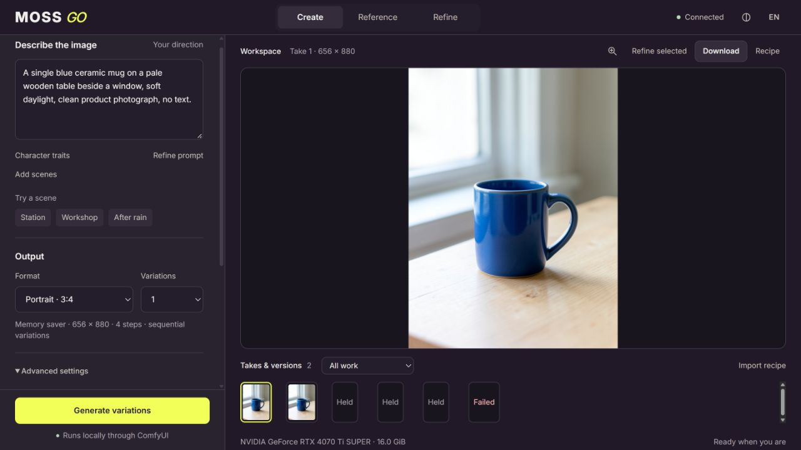

# Models, licenses and runtime

The model packs pin **files**, not just display names. Every entry in
[`model_manifest.json`](../moss_go/assets/model_manifest.json) includes its public
repository, immutable commit, source path, byte size, SHA-256 and license evidence.
The application does not silently replace a local model during generation.

## FLUX 3 — the recommended engine

Create, Reference and Refine default to **FLUX 3 Image Klein distilled**. The
tested runtime is ComfyUI **0.41.2**, source
`b53f77a74e21091cbdebfdf7b85fc80326932646`. Install the MOSS GO node pack for
feathered masks and addressed cancellation. The OpenMOSS plugin is only needed
when choosing a legacy MOSS engine.

The four official files come from
[BFL's ComfyUI repository](https://huggingface.co/black-forest-labs/flux-3-image-klein-comfy/tree/9d36114cf7a2e03a45c28f5cc4987d20ebfdb6c1).
The downloaded bytes were checked against all four published SHA-256 values.

| Role | Installed filename | Size | Upstream license |
| --- | --- | --- | --- |
| Distilled transformer | `flux3-image-klein-int8-convrot.safetensors` | 5.83 GB | FLUX Kommunity License v1.0 |
| Qwen3-VL 4B encoder | `qwen3vl_4b_int8_convrot.safetensors` | 4.86 GB | Apache-2.0 |
| Official Qwen3.5 9B upsampler | `qwen3.5_9b_flux3_prompt_upsampler_int8_convrot.safetensors` | 9.75 GB | Apache-2.0 |
| Compatible VAE | `flux3-vae.safetensors` | 0.34 GB | Apache-2.0 |

Total: **20.77 GB**, decimal, before the runtime, outputs and caches. The VAE's
official source filename is `vae/flux2-vae.safetensors`. MOSS GO installs the
identical bytes as `flux3-vae.safetensors` because its hash (`868fe7b3…`) differs
from the previous FLUX.2 pack's `d64f3a68…`. This avoids changing legacy recipes.
The manifest retains the exact upstream path and full hash.
The new VAE also exactly matches BFL's `FLUX.2-dev/ae.safetensors` at revision
`26afe3a78bb242c0a8bb181dcc8937bb16e5c66c`. The publisher's
[VAE Apache-2.0 release notice](https://bfl.ai/blog/flux-2) applies to that component;
no dev diffusion weights are selected from that repository.

Read and accept the
[model access conditions](https://huggingface.co/black-forest-labs/flux-3-image-klein-comfy)
yourself. FLUX weights are **not** covered by the application's Apache license.
Use your own accepted account and the official
[Hugging Face CLI](https://huggingface.co/docs/huggingface_hub/guides/cli):

```sh
hf auth login
moss-go-models plan --models-dir "/path/to/ComfyUI/models" --pack flux3-balanced
moss-go-models download --models-dir "/path/to/ComfyUI/models" --pack flux3-balanced
moss-go-models check --models-dir "/path/to/ComfyUI/models" --pack flux3-balanced
```

The source checkout also supports `python models.py` with the same arguments.
The installer reads `HF_TOKEN`, `HUGGING_FACE_HUB_TOKEN` or the existing local HF
token file (`HF_HOME` / `HF_TOKEN_PATH` are respected). It never accepts a license,
logs a token or forwards it to a CDN redirect. A 401/403 requires reviewing local
authentication/account access. Verified existing files need no download.

The adapter uses `CLIPLoader(type=flux3)`, actual `TextGenerate` prompt upsampling,
`ReferenceMultiLatent` for image conditioning, and `ModelSamplingFlux` shifts
ln(16). Distilled sampling is Euler/simple, CFG 1, normally 16 steps. Reference
images are resized within the selected canvas budget. Small edits use context
crops and source-coordinate compositing. These are distinct FLUX 3 graphs, not
FLUX.2 graphs with a renamed checkpoint.

The official upsampler is enabled by default and receives the reference/crop
when present. Turn it off only for an already detailed caption; the graph then
omits its loader and generation node. Readiness follows that explicit choice.
The actual expanded text is captured from ComfyUI history, never reconstructed.

INT8 runs were measured on RTX 4070 Ti SUPER **16 GB**, 32 GB RAM, Windows. The
upsampler approaches the available system-memory budget. Memory saver and BF16
high-precision configurations on other cards remain unverified. NVFP4 requires
different hardware and is not offered as an Ada fallback. See
[FLUX 3 measurements](FLUX3_BENCHMARK.md).

## Legacy FLUX.2 and MOSS packs

The following recorded pack inputs and measurements concern the previous release.
They remain selectable and preserve their separate component identifiers.

### Plan, check, download legacy packs

Run from the MOSS GO checkout. `--models-dir` is the existing **models** directory
of the ComfyUI installation used by the studio, including its actual disk location
if you keep models separately.

```sh
python models.py plan --models-dir "../ComfyUI/models" --pack moss-balanced --pack flux-balanced
python models.py check --models-dir "../ComfyUI/models" --pack moss-balanced --pack flux-balanced
python models.py download --models-dir "../ComfyUI/models" --pack moss-balanced --pack flux-balanced
```

With isolated ComfyUI portable Python, replace `python` with the quoted path to
`python_embeded/python.exe`; `models.py` handles its module search path. After a
normal package install, `moss-go-models` accepts the same arguments.

- **plan** reads sizes without hashing or downloading. `present-unverified` is
  deliberately different from a checksum match.
- **check** reads each complete file and returns exit code 1 if any file is missing
  or different. It can take minutes on a slow disk.
- **download** verifies existing files and reuses exact matches. A conflicting
  file remains untouched. Move that file aside yourself if you want this pinned
  pack installed at the same path.
- Interrupted transfers remain in adjacent `.moss-go.part` files. Repeat the same
  command to resume. A server that ignores a Range request restarts the partial
  file; a mismatched byte range is rejected. Completed files appear only after
  size and SHA-256 match. No custom download URL, account token or paid API is used.
- An adjacent `.moss-go.lock` prevents concurrent installers for one file. After
  a process crash, first confirm no setup process is still running, then remove
  only that named lock before retrying. A full-size checksum mismatch also needs
  its named partial file moved aside. Automatic retries do not discard evidence.

Restart ComfyUI or refresh its model list after adding models, then reconnect the
studio. This tool installs model files only; it does not install nodes, update
ComfyUI, change GPU drivers, alter personal extensions or start generation.

## Exact benchmark inputs

| Pack | Diffusion model | Text encoder | VAE | Total download |
| --- | --- | --- | --- | --- |
| `moss-balanced` | MOSS SFT INT8 ConvRot | SFT Qwen3.5 9B W4A8 GPTQ | MOSS VAE bf16 | 10.97 GB |
| `flux-balanced` | FLUX.2 Klein **distilled 4B FP8** | Qwen3 4B | FLUX.2 VAE | 12.45 GB |

Sizes are decimal GB, before runtime, Python environment, outputs and caches.
Both packs require about 23.42 GB of model storage. Downloads are optional per
pack. The four-step FLUX graph uses the distilled model, not Klein Base or 9B.

The MOSS files are from
[Epyan's SFT conversion](https://huggingface.co/Epyan/MOSS-Image-SFT-ComfyUI/blob/8b31b8214b29861078be74964656ccd944f99e66/README.md).
They differ from current Comfy-Org MOSS files with similar names. The converter
identifies the OpenMOSS upstream and Apache-2.0 license. MOSS GO's recorded local
benchmark files match all three published SHA-256 values.

The FLUX diffusion file comes from
[Black Forest Labs](https://huggingface.co/black-forest-labs/FLUX.2-klein-4b-fp8/tree/5b4408e59397a4a37ccb46afe426d8ed86379441),
and its encoder from
[Comfy-Org Klein 4B](https://huggingface.co/Comfy-Org/Flux-2-Klein-4B/tree/5b3abca5c0dc1ecd4eaf3340868d09063fc1c965).
The VAE matches the earlier Comfy-Org FLUX.2 VAE repack exactly, hash `d64f3a68…`.
Although its hosting repository also contains a non-commercial diffusion model,
the **VAE itself** is explicitly released under Apache-2.0 in
[Black Forest Labs' announcement](https://bfl.ai/blog/flux-2). Only the VAE file is
selected from that repository. The newer Klein VAE package has a different file
hash (`868fe7b3…`); this manifest preserves the file used in the benchmark. No
claim of byte or tensor equivalence is made between those two packages.

## Tested loader family

- ComfyUI source revision: `08ff3c11b3a85eb07c2c06f21cb378ac2e086840`.
- OpenMOSS plugin revision: `599a039ec6f8108eecdd0d8c107ceade6863145e`, directory
  `comfyui/moss-image` in [OpenMOSS/MOSS-Image](https://github.com/OpenMOSS/MOSS-Image/tree/599a039ec6f8108eecdd0d8c107ceade6863145e/comfyui/moss-image).
- All 11 local plugin source/workflow/license files match that revision after
  CRLF/LF normalization. The runtime Python packages are recorded below; this is
  an observed development configuration, not a clean-install lockfile.

| Component | Observed version |
| --- | --- |
| Python | 3.13.12 |
| PyTorch | 2.14.1+cu130 |
| comfy-kitchen | 0.2.37 |
| comfy-aimdo | 0.5.6 |
| transformers / tokenizers | 5.19.0 / 0.23.3 |
| safetensors | 0.8.0 |
| aiohttp / Pillow | 3.14.4 / 12.3.0 |

The MOSS graph uses **plugin** `MOSSImageUNETLoader` and `MOSSImageCLIPLoader`,
with `ModelSamplingSD3`, shift 5, Euler / sgm_uniform and single SLG layer 22.
Do not substitute native `UNETLoader` / `CLIPLoader(type=moss_image)` into that
graph. The [OpenMOSS guide](https://github.com/OpenMOSS/MOSS-Image/blob/2b46b1e0e13b5aaec253879e0d006a42564b8b27/comfyui/README.md)
documents a different native timestep multiplier and a corresponding AuraFlow
shift node. Switching loader families requires a separate tested workflow.

## Hardware evidence and remaining gates

Generation and reference/refinement benchmarks ran on RTX 4070 Ti SUPER 16 GB,
32 GB RAM, Windows. Memory saver was exercised on that same card. **A 12 GB card
and a 24 GB card have not been physically validated.** CPU text encoding, smaller
canvases and serial variations reduce demand; they do not guarantee a particular
GPU will fit every job. Free VRAM also changes while other programs use the card.

Readiness uses complete generated-node requirements for each supported mode,
including mask/crop/restoration dependencies. It is separate from physical
hardware validation. A missing refinement node blocks Refine while leaving Create
available. Check again refreshes cached schemas immediately. The panel checks
file names and node availability, not on-disk SHA-256; use `check` for provenance.

Controlled GPU-memory and system-RAM failure responses were exercised without
deliberately exhausting the machine. Unsubmitted siblings were held, earlier
results and independent work were retained, and preparation did not launch jobs.
A real FLUX recovery on the 16 GB reference card completed at 656×880, four steps,
CPU text encoding, original seed/prompt. An extra request verified corrected
version lineage using cached native computation; it is not another quality trial.
Memory saver reduces VRAM demand by moving the encoder into RAM; it is not the
automatic recovery recommendation for a system-RAM failure.



The development UI after recovery. The image was generated by FLUX; the second
saved attempt verified version linkage using cached computation.

High precision and experimental MOSS CharRef use additional files. They are not
included in the default verified packs. CharRef's published license and local
weight hash are recorded in [DEPENDENCIES.md](DEPENDENCIES.md). A clean GPU
dependency installation and additional physical GPUs remain unverified.
The standalone studio has its own hashed dependency locks, fresh Windows
source/wheel checks and passing hosted Windows/Ubuntu CPU CI; see [INSTALL.md](INSTALL.md).
